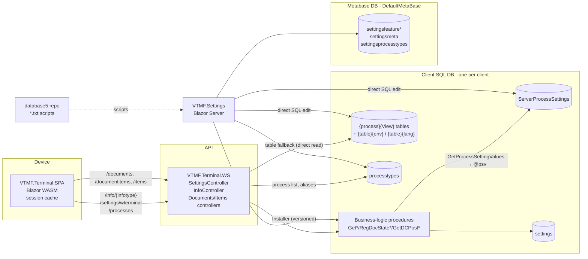

# VTMF Settings Architecture — Design-Time Reference

> **Status:** v1.1 — 2026-10-14. Initial analysis, reviewed and corrected by the product owner, produced from source of VTMF.Settings, VTMF.Terminal.SPA,
> VTMF.Terminal.WS and the SQL repository `database5`. Details are added incrementally whenever a new tool,
> skill or agent is designed.

## 1. Purpose and scope

This document describes holistically how *settings* work across the VTMF system. It is a **design-time
reference** used when creating tools, skills and agents that manage settings and business-logic procedures.
It is **not** read during daily work — daily tasks use only the focused tools, skills and agent files derived
from it.

Target use cases the tooling must eventually support:

1. **Apply a behaviour** — "Client X has shelves, uses batches and GS1 barcodes. Apply the supporting settings to the delivery process."
2. **Clone between clients** — "Client Y delivery behaves like client Z. Apply Y's delivery settings to Z as initial."
3. **Customizability check** — "Client Z delivery document loading should work as … Is it settings-customizable? If not, propose procedure or terminal changes."

Out of scope: a full inventory of settings (it is evolving; tools must discover it on demand), per-setting semantics
(belongs to the metabase / knowledge-capture tooling).

Source locations:

| Component | Path |
|---|---|
| VTMF.Settings (this repo) | `C:\PROJECTS\VTMF\Settingmanager\VTMF.Settings` |
| VTMF.Terminal.SPA | `C:\PROJECTS\VTMF\VTMFTERMINAL\VTMF.Terminal.SPA` |
| VTMF.Terminal.WS | `C:\PROJECTS\VTMF\VTMFTERMINAL\VTMF.Terminal.WS` |
| Shared types (`Setting`, `ListSetting`) | `C:\PROJECTS\VTMF\VTMFTERMINAL\VTMF.Terminal.Types` |
| SQL source of truth (all procedures/tables) | `C:\PROJECTS\VTMF\SAWMILL2\Sawmill\database5` |
| SQL installer library | `C:\PROJECTS\VTMF\SQLDEPLOYMENT\sql-installer\VTMF.SQLInstaller` |

## 2. System map



- **Client DB** contains everything that executes: procedures, settings tables, process registry. One DB per client; all
  clients run the centrally maintained procedures from `database5`.
- **WS** is a thin, generic gateway: it maps routes to procedure names by convention and passes settings through. It
  holds no cache. Running processes are defined by `processtypes` (process list via `GetProcessTypes`, aliases via
  `SETTINGPROCEDURES` / `DATAPROCEDURES`).
- **SPA** executes the process UI logic, driven by ProcessSettings and layouts; caches settings for the session.
- **VTMF.Settings** edits settings tables directly, manages the metabase, and installs procedures.
- **Metabase** (`DefaultMetaBase`, selectable per client via `MetaBaseName`) holds feature definitions and setting
  descriptions. It is used **only by VTMF.Settings** — there is no runtime dependency from WS, SPA or procedures.
  Its DDL is not under version control yet (can be added on request).

## 3. Storage taxonomy

All settings tables share the same row shape:

| Column | Meaning |
|---|---|
| `NAME` | Dot-hierarchical name (e.g. `Document.State.Terminal.New`, `Column.QTY.Caption`) |
| `VALUE` | Value (for `SettingGroup` rows: the group member, e.g. a field name) |
| `settingtype` | `Setting` \| `SettingGroup` \| `ListSetting` \| `ServerSetting` (see below) |
| `LISTVALUE` | Secondary value / list payload |
| `workercode` | Layer key — meaning differs per table (see below) |
| `ordernr` | Ordering; in `settings`: 0 = scalar, >0 = list item |

**`ServerSetting`** is a special type for **sensitive settings** (API keys, credentials, integration endpoints).
They are filtered out when settings are served to the frontend and must never leave the backend. Tools and agents
must treat them as secrets: never copy them into features, prompts, logs or outputs in clear text, and never move
them to a frontend table.

### 3.1 `settings` — global settings
`database5/settings/001-table-settings.txt`. Unique (`workercode`, `NAME`, `ordernr`). `workercode` = `ALL` or a worker.
Holds global/frontend-global values (`BarcodeKeyboard.*`, `Directo.ApiKey`, `DCIntegration.Baseuri`,
`Directo.Workercodesource`, `Processtypes.Defaulthidden`) and a few legacy process-prefixed names.
Seeded idempotently by scripts (`settings/050-script-defaultsettings.txt`, `worker/008-…`) and via `SaveSetting`
(XML `<add key value …>` — same format as `basesettings/Settings.config` and client `.config` files under
`directo/process/spasettings/`). **Not managed by VTMF.Settings.**

### 3.2 `ServerProcessSettings` — backend process settings
`database5/settings/024-table-ServerProcessSettings.txt`. Unique (`NAME`, `workercode`).
`NAME = '{process}.{Setting.Path}'`; `workercode` = `ALL` or a worker code. The per-worker layer exists technically
but is **discouraged** — variation should be expressed by environment, language (translatable settings) or a
separate process type that overrides/aliases the base process.
These mutate the behaviour of the business-logic procedures. **Not seeded by any script** — filled via VTMF.Settings
(which shows it with the `{process}.` prefix stripped) or `SaveProcessSetting`.

### 3.3 `{process}{View}` — frontend settings tables
One table per process and view, e.g. `spaorderassemblingProcessSettings`, `spaorderassemblingDocumentListLayout`,
`spaorderassemblingDocumentItemsListLayout`, `…ArticleCardLayout`, `…SearchCardLayout`, `…ILPEListLayoutInfo`.
Created by `###-table-{process}Settings.txt` in each process `*base` folder (template copy, `IF NOT EXISTS`), or
dynamically by `SaveProcessSetting` / VTMF.Settings `EnsureSettingTable`.

- `ProcessSettings` table = behaviour mutations of SPA process logic.
- `*Layout` tables = configuration of one view, including its local behaviour (`Function.*`, `Column.*`, `Toolbar.*`).
- `workercode` holds `ALL` or an **environment name** — there is **no per-worker layer** in frontend tables.
- Overlay tables: `{table}{environment}` (rows with `workercode={environment}`) and `{table}{language}`
  (rows with `workercode='ALL'`). Looked up by name; no script in `database5` creates them.
  `{table}{lang}` is the **recommended** way to define language overrides (piloted at one client, not yet widespread).
- Frontend tables will **not** get a per-worker layer (worker-level settings are discouraged).

### 3.4 `processtypes` — process registry
`database5/worker/002-table-processtypes.txt`. Key columns:

| Column | Role |
|---|---|
| `NAME` | Process name, lowercase (WS splits infotypes at the first uppercase letter) |
| `PROCESSTYPE` | Selects the SPA component (`TaskDocument`, `RelocateItems`, `ItemList`, …) |
| `SETTINGPROCEDURES` | Settings alias/parent — process reuses another process's settings tables/procedures |
| `DATAPROCEDURES` | Data-procedure alias — process reuses another process's data procedures |
| `ENVIRONMENT`, `WORKERGROUPS`, `DEFAULTVISIBLE`, `AUTOSTART`, `SCREEN`, `ORDERNR` | Visibility and launch |

Process variants (e.g. `spaorderassemblinggrouped`, `spaorderassemblingsign` → `spaorderassembling`) share settings
through `SETTINGPROCEDURES` rather than copies. Visibility per worker also comes from `workerprocesses` and
`workerproperty`.

### 3.5 Metabase (`DefaultMetaBase`)
Tables used by VTMF.Settings: `settingsfeature`, `settingsfeaturevalues`, `settingsfeaturegroup`,
`settingsfeaturegroupfeature`, `settingsmeta` (description, value type, values list), `settingsprocesstypes`.
See §8.2 for the feature model. Coverage is marginal today.

### 3.6 Other settings-like stores
`workerproperty`, `tblworkerpropertyProcessSettings`, `assemblingroundCourierSettings`, `spamovementsetup`
(per-worker setup values), `dcquerysettings` (route → Directo posting procedure map). Audit tables created by
VTMF.Settings: `settingslog`, `settingssession`.

## 4. Resolution

Layer inputs come from the user's JWT in WS (`VTMF.Terminal.WS\Utilities\UserUtilities.cs`):
**workercode** (claim selected by config `WorkerCodeSource`), **environment** (claim `…/environment`, default
`DefaultEnvironment` → `wterminal`), **language** (claim `…/lang`, default `DefaultLanguage` → `et`). An optional
`location` query parameter is folded into environment as `{env}@{location}`. Client DB selection: claim
`…/application` → connection string `{X}Context` (`AuthorizationMode=UserApplication`).

### 4.1 Backend settings — procedures

**Recommended pattern (bulk, `@psv`)** — `settings/035-function-GetProcessSettingValues.txt`:

```sql
declare @psv dbo.processSettings
insert into @psv select * from dbo.GetProcessSettingValues(@processname, @workercode)
declare @newState nvarchar(30) = dbo.GetPSV(@psv, 'Document.State.Terminal.New', 'UUS')
```

Resolution per key: (1) worker row, (2) process `ALL` row, (3) `SETTINGPROCEDURES` parent `ALL` row (fallback).
Empty values are dropped. Worker rows are skipped for worker codes containing `@` or equal to `wterminal`.
Accessors: `GetPSV` (string), `GetPSVI` (int), `GetPSVB` (bool, only `true`/`false`), `GetWSN` (worker-specific
name fragment, e.g. `Print.ARTICLECODE.{wsn}.Printer`).

**Legacy pattern (anti-pattern)** — `GetProcessSettingValue[Int|Dec](process, name, workercode, default)` reads each
setting separately and **replaces** the process with its `SETTINGPROCEDURES` parent instead of falling back.
Rule: **whenever a procedure is changed, its legacy reads are converted to the `@psv` pattern** (incremental
migration). Note the semantic shift during conversion for aliased processes (replace → fallback).

Defaults live **in code** at each call site (often Estonian literals: `UUS`, `TOOS`, `VALMIS`, `POOLELI`). This is
**intentional**: the default must be explicitly visible in the given procedure/process, even when the same setting
name appears elsewhere with the same default. No separate default layer will be introduced. Consequence for tools:
the effective value of an unset setting is per call site — the catalogue must record defaults per procedure.

Global settings: `GetSettingValue(name, workercode)` / `GetIntSettingValue` — worker row, then `ALL`.

### 4.2 Frontend settings — WS `InfoController`

Scope in WS: `SettingsController` and `InfoController` (plus `ProcessesController` for the process list).
`SafWsController` is obsolete and out of scope.

`GET|POST /info/{infotype}?objectname&objectkey&query&location` → `InfoController.SubmitInfo`:

1. If procedure `dbo.Get{infotype}Info` exists → it is executed and **fully determines the result**.
   Parameters: `@workercode, @objectname, @objectkey, @query`, plus `@environment`, `@processname`, `@language`,
   `@threadid` *only if the procedure declares them*.
2. Else, if `infotype` ends with `Layout` or `ProcessSettings`: table fallback.
   - Split `infotype` → `processName` (lowercase prefix) + suffix.
   - Candidate tables: `{processName}{suffix}`, `{SETTINGPROCEDURES alias}{suffix}`, `{infotype}`; first existing wins.
   - `Readers\LayoutListSettingReader.Read`: base rows `workercode='ALL'` (non-empty, by `ordernr`) → overlay
     `{table}{environment}` (if env ≠ `wterminal`; `Setting` overrides by NAME, `SettingGroup` added if NAME+VALUE new)
     → overlay `{table}{language}`.
   - Then `dbo.Get{table}Additional` (if exists) is merged in.
3. Else alias procedure `Get{alias}{suffix}Info`; missing → empty result (no error).

Procedure result shape: first row `VALUE='Response'`; subsequent rows `VALUE`=setting name, `LISTVALUE`=value
(different column mapping than the table path).

Inside `Get{process}{View}Info` procedures (`database5`): base `ALL` rows; only **14 of 94** apply the environment
overlay (`@env = coalesce(nullif(@environment,'wterminal'),'ALL')`); none apply worker overrides.

### 4.3 Global frontend settings — `SettingsController`
`GET /settings/{name}` (SPA always calls `/settings/wterminal`) → `dbo.GetSettings(@workercode, @name, @environment)`:
worker row before `ALL`; `@environment` and `@name` are currently ignored by the procedure.

### 4.4 Intended vs actual — summary

| Intended rule | Actual behaviour |
|---|---|
| Settings never read directly from tables | WS table fallback reads frontend tables directly; ~15 procedures read layout tables or `settings` directly |
| Layering by workercode (discouraged) | Exists in `ServerProcessSettings` and `settings`; intentionally absent for frontend tables |
| Layering by environment (preferred) | WS table fallback + 14 `*Info` procedures; ignored elsewhere |
| Layering by language (preferred for translatable settings) | Via `{table}{lang}` overlay tables (WS) and two procedures; pilot at one client |
| One resolution semantics | Legacy scalar vs `@psv` differ for aliased processes |

## 5. Consumption

### 5.1 The process model
A **process** is a `processtypes` row. `PROCESSTYPE` selects which SPA component implements the UI
(`TaskDocument`, `RelocateItems`, `ItemList`, `ViewDocument`, `UpdateItem`, `Workorder`, …). From the settings
perspective all processes are architecturally the same: each has backend settings in `ServerProcessSettings`
(`{process}.*`), frontend tables `{process}{View}`, and procedures named `{Verb}{…}For{process}` /
`Get{process}{View}Info`. Different processes simply use different views, procedures and setting families according
to their purpose.

### 5.2 Backend procedure pattern
Per process, under `database5/directo/process/{process}base/` (terminal logic) and `{process}/` (ERP posting).
File numeric prefix = invocation order. Route → procedure conventions in WS (with `DATAPROCEDURES` alias fallback):

| Route | Procedure |
|---|---|
| `GET /documents/process/{p}` | `GetDocumentsFor{p}` |
| `GET /documentitems/document/{p}/{key}` | `GetDocumentItemsFor{p}` |
| `POST /documents/postitem/state/{p}/{state}` | `RegDocStateFor{p}{state}` |
| `POST /items/postitem/state/{p}/{state}` | `RegDocItemStateFor{p}{state}` |
| `GET /info/{infotype}` | `Get{infotype}Info` (+ `Get{table}Additional`) |
| — (posting) | `GetDCPost{Action}Xmldata` via `dcquerysettings` routes |

State-endpoint parameters are bound by name from the request body; `@workercode` always from the token; a result
starting with `ERROR:` → HTTP 451.

### 5.3 SPA
Three channels (`VTMF.Terminal.SPA`):

1. **Global settings** — `Services\SettingsService.cs` `LoadSettings` once after login: merges config
   (`terminal.json`), optional `SettingsUrl`, and `/settings/wterminal`. Misses are recorded and visible at
   `/missingsettings`.
2. **ProcessSettings** — `Processes\ProcessBase.cs` `LoadProcessSettings` → `GetInfo("{proc}ProcessSettings")`.
3. **Layouts** — `UIComponents\BaseProcessUI.cs` `LoadListLayout` → `{proc}{Document|DocumentItems}ListLayout`;
   `ItemListPropertyEditor` → `{proc}{Editor}Layout`; `ItemCard` → `{itemclass}CardLayout` (uncached).

Access: string keys via `ListSetting.GetSettingValue / GetBoolSettingValue / GetIntSettingValue`, case-insensitive,
defaults as literals at each call site, prefix enumeration (`StartsWith("Function.Barcode.Patterns.")`).

Layout structure: flat ordered NAME/VALUE list. Group rows define membership and order
(`Column=<field>`, `Toolbar.Item=<name>`, `Command=<name>`, `Detail.<x>` — `settingtype='SettingGroup'`), attribute rows
`Column.{field}.{Attr}` (`Caption`, `Hidden`, `FieldType`, `DisplayFormat`, `Width`, `EditType`, `ReadOnly`,
`Required`, `Barcode`, `FieldMap`, …), grid-wide `Grid.*`, view-local behaviour `Function.*`.

Server-driven views: some processes (e.g. `sparelocateitems`) send each scan to `Get{proc}KeyboardEventTypeInfo`,
whose response (`ObjectType`, `Action.*`, `Option.*`) drives the UI. Behaviour there is controlled by backend
settings read in that procedure (`Keycode.*`, `Action.*`).

## 6. Naming grammar and discovery

### 6.1 Grammar
`{Scope}.{Subject}.{Field}.{Attribute}` with dynamic segments.

| Area | Families |
|---|---|
| Backend (`ServerProcessSettings`) | `Document.State.{Terminal\|Directo}.*`, `Document.Query.*`, `Document.Datafield.{f}.Response\|Format`, `Documentitem.Datafield.{f}.Response\|Format\|Round`, `Document.RegDocState.*`, `Message.{RegDocState\|RegDocItemState}.{Action}.*`, `Directo.{Doc}.*`, `Print.*`, `Keycode.*`, `Action.*`, `Create.{from}.{to}.*`, `Item.Datafield.*` |
| ProcessSettings (SPA) | `Function.Barcode.*` (Parser, Rowidentifier, Patterns, Notfound/Multifound actions, SearchOrder, OnRead), `Function.Location.*`, `Function.OnStart`, `Function.NewDocument.*`, `Process.EditItem.*`, `Process.DocumentAction.{a}.*`, `ErrorMessage.*` |
| Layouts (SPA) | `Column.{f}.*`, `Grid.*`, `Toolbar.*`, `Command.*`, `EditPopup.*`, `Function.BarcodeColumn`, `Function.UniqueSelect.*`, `Function.ValidationMode`, `Function.Serial.*` |

Dynamic segments: `{fromstock}.{tostock}`, `{unit}`, `{wsn}`, `{workercode}`, `{action}`, `{field}`.
Inconsistencies exist (`Documentitem.*` vs `DocumentItem.*`).

### 6.2 Discovery techniques (no self-description exists)
- **SQL**: regex over procedure bodies — `GetPSV[IB]?\(@\w+,\s*'([^']+)'\s*,\s*([^)]*)\)` and
  `GetProcessSettingValue(Int|Dec)?\(\s*('\w+'|@\w+)\s*,\s*'([^']+)'`. Enclosing procedure + file prefix give process,
  invocation step and default. `ShowAllServerSettings` does this in-DB but misses `@psv` reads.
  Note: some `database5` files are UTF-16 — use ripgrep or decode first.
- **Branching**: setting variables are named after the setting (`@docqueryJoin`), so behaviour branches are visible
  as `if @var = 'True'`.
- **SPA**: static scan for literal keys (`"Function.…"`, `$"Column.{x}.…"`) in `TaskDocument.razor(.cs)`,
  `RelocateItems.razor(.cs)`, `ItemGrid2.razor(.cs)`, `ItemListPropertyEditor.razor.cs`, `BaseProcessUI.cs`,
  `ItemCard.razor.cs`, `ItemList.razor.cs`, `DataService.cs`. Closed value sets are found in `switch` statements
  (`Barcode.BuildRowIdentifier`, `ItemListPropertyEditor.UseBarcode`, `TaskDocument.GotKeyboardEvent`).
- **Runtime**: SPA `/missingsettings` (only `SettingsService` lookups).
- **Live data**: a configured client's tables show which settings are actually used — the basis for harvesting
  features.

## 7. Worked examples

### 7.1 Delivery — `spaorderassembling`
Variants `spaorderassemblinggrouped`, `spaorderassemblingsign` (via `SETTINGPROCEDURES`); viewer
`spadeliveryviewer` (hardcodes `spaorderassembling` settings). Folders `directo/process/spaorderassemblingbase/`,
`directo/process/spaorderassembling/`.

| Step | Procedure | Settings |
|---|---|---|
| 025 | `GetspaorderassemblingProcessSettingsInfo` | Frontend `spaorderassemblingProcessSettings` (env-aware) |
| 040 | `…DocumentListLayoutInfo` | `spaorderassemblingDocumentListLayout` (env-aware) |
| 050 | `GetDocumentsForspaorderassembling` | `@psv`: `Document.State.Terminal.*`, `Document.State.Directo.*`, `Document.Query.{Join,Confirmed,Excludestock,Includestock,DocumentAge,…}`, `Document.State.Style.*`, `Document.Datafield.*` |
| 060/070 | `…DocumentItemsListLayoutInfo`, `GetDocumentItemsForspaorderassembling` | ~78 reads: `Documentitem.Datafield.*`, `Documentitem.Query.*` |
| 075 | `RegDocItemStateForspaorderassemblingArticleEdit` | `Message.RegDocItemState.ArticleEdit.*`, `DocumentItem.RegDocState.*` |
| 090 | `RegDocStateForspaorderassemblingFinished` | legacy reads: `Document.RegDocState.*`, `Directo.Delivery.*` |
| 092/093 | Hold, PrintLabel | `Print.*` |
| posting | `GetDCPostAssemblingDeliveryXmldata` | `Directo.Delivery.*` |

SPA side (TaskDocument component): ProcessSettings `Function.Barcode.*`, `Function.Location.*`, `Function.OnStart`;
layouts `spaorderassemblingDocumentListLayout`, `spaorderassemblingDocumentItemsListLayout`, ILPE layout
(`Function.ValidationMode`, `Column.{f}.Barcode` for batches/serials).

Use-case 1 relevance: GS1 → `Function.Barcode.Parser=Parserbuilder`, `Function.Barcode.Rowidentifier`
(e.g. `PRCLOT`); batches → ILPE `Function.ValidationMode`, `Column.{f}.Barcode=LOT…`, `FieldMap`; shelves →
`Function.Location.*`, `Function.{Read|Check}.Location.Required` plus backend `Documentitem.Datafield.*`.

### 7.2 Location change — `sparelocateitems`
No document list; scan → recognise → item card → action.

| Step | Procedure | Settings |
|---|---|---|
| 008 | `GetsparelocateitemsProcessSettingsInfo-` (dash-suffixed, see §8.4) | — |
| 010 | `GetsparelocateitemsKeyboardEventTypeInfo` | `Keycode.{LocationMatch,LocationPrefix,Search*,TrimPaddingZeros,MaxResults}`, `Action.*` |
| 020 | `GetsparelocateitemsArticleItem` | `Item.Datafield.*` |
| 030–033 | `RegDocItemStateForsparelocateitems{Location,ResetLocation*}` | `Keycode.*` |
| 060 | `SetBarcode` | `Action.SetBarcode.AllowOverwrite`, `Action.GTIN14ToEAN13` |
| posting | `GetDCPostRelocateLocationXmldata` | — |

## 8. Management today

### 8.1 VTMF.Settings
Services (`Services/`, singletons): `SettingsService` (client frontend tables + `ServerProcessSettings` +
`processtypes`), `SettingMetaService` and `FeatureManagementService` (metabase), `FeatureService`, `WorkerService`,
`SchedulerService`, `WikiService`. Client selection via route `/{page}/{ClientName}/…`;
connections from `SqlConnectionParameters` (`SqlConnectionProvider`).

Characteristics relevant to tooling:
- Direct inline SQL on tables. This is the current state, **not a rule**: settings-management procedures were hard
  to bootstrap because VTMF.Settings is itself the tool that populates the database. Stored procedures as
  settings-management tools are **preferred** going forward (deployed through the installer like any other set).
- Only `workercode='ALL'` is visible/editable — a gap for environment and language overlays (worker-level is
  discouraged anyway). `CopySettings`, `RestoreBackup`, `DeleteSubNodes` delete other-workercode rows
  (environment overrides) without restoring them.
- Table discovery: `INFORMATION_SCHEMA` tables with a `settingtype` column, prefixed by the process name.
- Copy between clients: whole table, clear-then-insert, no preview.
- Backup: `SELECT * INTO bck_{table}_{timestamp}`.
- Audit: `settingslog` (shared SQL login), partial coverage, no reader UI.
- No transactions, no dry-run, no diff, no validation against `settingsmeta`.
- No authentication.
- Service layer is UI-free enough to be lifted into a library/MCP host; write operations need a new transactional
  layer.

### 8.2 Feature model (metabase)
- `settingsfeature` keyed by `processtypename`, `tablename` (view suffix), `parentsettingname` (may end `.*`),
  `featurename`; `featuretype` ∈ `SettingGroup`, `SettingReplace`, `SettingUpdate`, `SettingMove`.
- `settingsfeaturevalues`: `settingname`, `settingvalue`, `settingvaluetype` (String/Number/Boolean/List/Remove),
  `order`, `promptonapply`, `storetable`; placeholders `{{parentname}}`, `{{parentpath}}`, `{{settingname}}`.
- `settingsfeaturegroup` + `settingsfeaturegroupfeature`: batches of features.
- Applying a single feature works per tree node (non-atomic). Applying a feature group (`FeatureService.ApplyFeature`)
  is a stub; group membership cannot be authored in the UI.
- Harvesting exists in a basic form: `SelectFeatureSettingValues.razor` captures values from a live client table into
  a feature.
- Features cover frontend tables; backend `ServerProcessSettings` is reachable through `storetable`.

Direction: the metabase is the **future store for features and feature sets** — where harvested behaviours are kept
and retrieved by agents. Installing a feature should become its **own tool as a stored procedure**; the current
VTMF.Settings apply code is complex and fragile and should not be the basis.

### 8.3 Procedure installation
`Components/Pages/Installer.razor` + `VTMF.SQLInstaller`. `install.xml` defines sets (`base`, `directocore`, process
sets…) pointing at `database5` folders. Script version from TFVC (or `versions.csv`, maintained by a git pre-commit
hook — never edited manually); installed version from `dbo.SetupCheckInstall`; installs newer scripts batch-by-batch
and records via `SetupRegisterInstallation`. Validate mode = dry run.
Direction: TFVC is being phased out — `install.xml` and versions will come from the git repo (`database5`) in the
near future.

### 8.4 Client customization mechanisms
- **Alternative module folders** defining the same procedure names (e.g. `spastockreturn/` vs
  `spastockreturnlocal/`, `spaincomeorderbase` vs `spaincomeordercr`); whichever set is installed wins.
- **Dash-suffixed procedures** (`GetsparelocateitemsProcessSettingsInfo-`) — a visible marker that the procedure is
  not in use (WS falls back to the table path); can be turned back on by restoring the name.
- **Aliasing** through `processtypes.SETTINGPROCEDURES` / `DATAPROCEDURES`.
- **Client `.config` files** for global settings (`directo/process/spasettings/{client}.config`).
- Procedures changed directly in a client DB are not detected; the installer overwrites them when the repo version is
  newer.

## 9. Change propagation

| Change | Visible to WS | Visible on device |
|---|---|---|
| Frontend table / ProcessSettings / layout row | Next request (WS has no cache) | After SPA full reload / re-login (session cache, no invalidation) |
| Global `settings` | Next request | After re-login |
| `ServerProcessSettings` | Next procedure call | Next server round-trip |
| Procedure install | Immediately | Immediately (server-side logic) |

SPA cache key omits `location`; `DataService.Configure` applies only the first opened process's tuning settings.

## 10. Gaps, anti-patterns, bugs

**Anti-patterns**
- Legacy per-setting backend reads (`GetProcessSettingValue*`) — replace with `@psv` when touching a procedure.
- Direct reads of `settings` (`worker/005 GetProcessTypes`, `dcusers/010`, `023`, `directomodule/025`), of
  `ServerProcessSettings` (`spaorderassembling/071`), and of frontend layout tables from backend procedures
  (`spaorderassemblingbase/131,146`; `spamovementbase/055,131,145,152,156,160,220`; `spaincomeordercr/170`;
  `spaincomeorderbase/070`).
- Hardcoded process names in procedures (e.g. `'spaorderassembling'` in `090`, `105`; `'sparelocateitems'` in print
  procedures) break aliasing.
- Estonian literals in procedures and SPA (defaults in code are intentional — see §4.1).
- SPA: no settings model; keys scattered; duplicated loading code in `RelocateItems`; singleton barcode parser state.

**Bugs worth knowing**
- `GetPSVI`: configured `0` returns the default; `GetPSV` truncates to 160 chars.
- `spadeliveryviewer/040` `ALTER`s `GetspaorderassemblingDocumentListLayoutInfo` (non-env-aware version).
- `sparelocateitemsbase/020`: `@searchSecond` reads `Keycode.SearchFirst`.
- WS `LayoutListSettingReader`: language overrides can't match env-only rows; `SettingGroup` overrides in
  `MergeListSettings` never match (appended).
- VTMF.Settings: `GetMaxOrderNr/GetMinOrderNr` with null prefix → invalid SQL; `GetBackupInfo` orders by a missing
  column; `ServerProcessSettings` copy likely double-prefixes; `AddNewSetting` reports success on failure;
  `FeatureManagementService` uses `DefaultMetaBase` while others use the per-client metabase.

## 11. Implications for tools, skills and agents

Requirements derived from the analysis, grouped by the roadmap items.

**Knowledge capture (roadmap #2)**
- A **settings catalogue** built by code scans (SQL `@psv`/legacy reads with defaults; SPA literal keys) per process
  and view, refreshed on demand — the base layer of what settings exist.
- **Harvesting** a behaviour from a configured client: diff the client against a baseline (another client or code
  defaults) and save the relevant subset as a metabase feature with description.
- Feature definitions must cover both frontend tables and `ServerProcessSettings`.

**Tool surface (roadmap #3)**
- Read tools: clients, processes (incl. aliases), views/tables, effective settings, features.
- Effective-value view must replicate actual resolution (§4), not just `ALL` rows — and flag when a
  `Get{…}Info` procedure overrides a table.
- Write tools must be **plan → diff → apply**: transactional, preserving non-`ALL` rows, with backup of affected
  rows. Identity of modifications = the SQL username in the connection string (as today).
- Pre-write checks: overriding `Get…Info` procedure exists? process uses an alias (write to the parent instead)?
  table exists? Variation requested per worker → propose environment, language or a process-type override instead.
- `ServerSetting` rows are secrets: masked in reads, never exported into features or moved to frontend tables.
- Post-write notice: SPA reload required (§9).
- Preferred host: **stored procedures** in each client DB as the settings-management tools (feature install,
  diff, apply, effective-value read), deployed from `database5` by the installer. VTMF.Settings provides client
  connections to agents (or connection strings from the Windows Credential Store) and may expose read/orchestration
  services via MCP.

**Skills / agents per use case (roadmap #4)**
- *Apply behaviour*: map behaviour → features (metabase) → plan → diff → apply. Falls back to catalogue search when no
  feature exists.
- *Clone between clients*: per-process diff of all tables (frontend + `ServerProcessSettings`) between two clients,
  selective apply, aliasing-aware, environment rows preserved.
- *Customizability check*: locate the procedures for the behaviour (route conventions §5.2, invocation order),
  list settings read there (catalogue), decide; if not customizable, propose a procedure change in `database5`
  (converting legacy reads to `@psv`) or an SPA change.

## 12. Decisions and open items

| # | Topic | Decision |
|---|---|---|
| 1 | Metabase DDL | Not under version control; to be added when needed by tooling |
| 2 | Language overrides | `{table}{lang}` is the recommended mechanism (pilot at one client) |
| 3 | Dash-suffixed procedures | Visibility marker for "not in use"; reversible |
| 4 | Per-worker layer for frontend tables | No — worker-level settings are discouraged |
| 5 | Agent connections and identity | Connections via VTMF.Settings (or Windows Credential Store); SQL username = modification identity |
| 6 | Defaults | Stay in code per call site; no separate default layer |
| 7 | Settings-management implementation | Stored procedures preferred over inline SQL in VTMF.Settings |
| 8 | Feature installation | New stored-procedure tool; metabase is the feature store |
| 9 | Procedure source | `install.xml` and versions move from TFVC to git |
